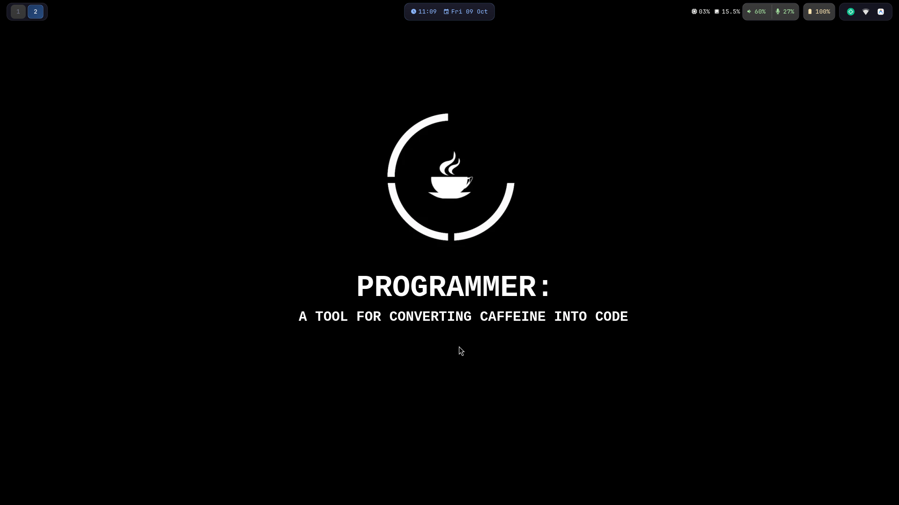

# Ironbar Islands

A modern, minimalist floating-island status bar configuration for Wayland and Niri, styled with Catppuccin Mocha.



## Features

- **Floating Island Layout:** Segmented capsule modules with balanced margins, subtle borders, and soft shadows.
- **Catppuccin Mocha Palette:** Pure design tokens via native GTK CSS `@define-color` directives.
- **Dedicated Audio & Mic Indicators:** Distinct glyphs and percentage readouts for speaker output and microphone input, separated by a clean vertical divider.
- **Unified Battery Indicator:** Minimalist single glyph with battery level—no duplicate GTK icons.
- **Padded System Tray:** Evenly spaced StatusNotifierItem (SNI) icons with subtle hover states.
- **Compositor Agnostic:** Tailored for Niri, fully compatible with Hyprland, Sway, River, and other Wayland compositors.

## Requirements

Ensure the following packages are installed on your system:

| Dependency | Purpose | Arch Linux Package |
|---|---|---|
| [Ironbar](https://github.com/JakeStanger/ironbar) | Wayland status bar | `ironbar` (or `ironbar-git`) |
| [JetBrainsMono Nerd Font](https://www.nerdfonts.com/) | Icons and monospace typography | `ttf-jetbrains-mono-nerd` |
| [Papirus Icon Theme](https://github.com/PapirusDevelopmentTeam/papirus-icon-theme) | System tray icons | `papirus-icon-theme` |
| PipeWire / PulseAudio | Volume and microphone status | `pipewire` / `pipewire-pulse` |

## Installation

### Automated

Clone the repository and run the installation script:

```bash
git clone https://github.com/barisatay0/ironbar-islands.git
cd ironbar-islands
./install.sh
```

The script automatically creates a backup of any existing `~/.config/ironbar` directory before applying files, and reloads Ironbar if it is running.

### Manual

Copy `config.corn` and `style.css` to your Ironbar configuration directory:

```bash
mkdir -p ~/.config/ironbar
cp config.corn ~/.config/ironbar/config.corn
cp style.css ~/.config/ironbar/style.css
```

Then reload the bar:

```bash
ironbar reload
```

## Project Structure

```text
ironbar-islands/
├── assets/
│   └── preview.png      # Screenshot
├── config.corn          # Ironbar layout and module settings
├── style.css            # Catppuccin Mocha GTK4 styles
├── install.sh           # Installation script
├── LICENSE              # MIT License
├── VERSION              # Version identifier
└── README.md
```

## Customization

### Colors

Colors are defined at the top of `style.css`:

```css
@define-color base            #1e1e2e;
@define-color mantle          #181825;
@define-color text            #cdd6f4;
@define-color blue            #89b4fa;
@define-color green           #a6e3a1;
@define-color yellow          #f9e2af;
@define-color red             #f38ba8;
@define-color mauve           #cba6f7;
```

Modify these hex values to match your preferred theme.

### Dimensions and Offsets

Bar height, outer margins, and spacing can be adjusted in `config.corn`:

```corn
position = "top"
height = 36
margin.top = 6
margin.left = 10
margin.right = 10
```

## Contributing

Pull requests and issues are welcome.

## License

This project is licensed under the [MIT License](LICENSE).
